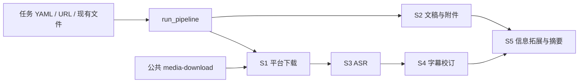

# dl-video 当前设计

核对日期：2026-11-12，以当前本地源码与 cfg/config.yaml 为准。历史方案和早期设计细节保留在 [项目演进记录](项目演进记录.md)、[整理前快照](baks/DESIGN-before-20261112-audit.md)；旧设计不再承担现行接口说明。

## 项目范围与结构

项目串联多平台媒体下载、文稿/附件读取、ASR、字幕校订和内容报告。统一入口是 `src/run_pipeline.py`，各步骤仍可独立运行；没有常驻服务或任务数据库。

图表示主要数据关系，不表示每个任务都必须执行全部节点。视频号跳过 S2；显式音视频从 S3、原始 SRT 从 S4、校订 SRT 从 S5 开始。Qwen 和 Whisper 当前都执行 S4。

| 位置 | 职责 |
|---|---|
| `src/run_pipeline.py` | 参数、任务/步骤计划、子进程、日志、产物发现、可选通知 |
| `src/s1_huifang.py`、`src/s1w_*.py` | 通用下载调度和平台实现 |
| `src/s2_wiki.py`、`src/s2w_yitang_wiki.py`、`src/url2md.py` | 文稿下载、结构化转换、附件、追加写入与本地导出 |
| `src/s3_subtitle.py`、`src/s3_speaker.py` | 多引擎识别及独立说话人后处理 |
| `src/s4_srt_fix.py`、`src/s5_addon.py` | 词典/LLM 校订、字幕/文稿/讨论区对照与摘要 |
| `src/modules/` | 配置、ffmpeg、进度、模型缓存、飞书授权/妙记/Cookie |
| `src/tools/` | 模型下载与校订日志过滤；旧下载路径保留转发 |
| `cfg/config.yaml` | 路径、规则、模型与步骤参数 |
| `cfg/input.yaml` | 本机任务与覆盖值，不入 Git |
| `prompt/` | 运行时提示词；cfg 下同名旧提示词不参与当前 S4/S5 加载 |
| `src/test_*.py` | 离线回归及少量真实平台调试，不能一概当作离线测试 |
| `batch_srtfix.py` | 固定目录的历史批处理，独立于主流程 |

## 配置和共享依赖

`load_config()` 先读 config.yaml，再按 include_input 决定是否浅合并 input.yaml，返回 `(config, creds)`。凭据从共享 secrets_loader 的 gkeys/gfeishu/gtokens 加载。app_a 补到运行时 feishu 应用字段，auth_dl-video 绑定/合并用户授权；刷新、锁与持久化委托共享 feishu-access。应用凭据、用户 Token 和浏览器 Cookie 是不同链路。

独立共享工具位于 `~/.local/share/arqiao-tools/`：secrets-loader、feishu-access、media-download。当前视频号适配层在 import 时检查公共实现，run_pipeline 顶层也导入它，所以即使只打印其他平台计划，也需该依赖存在。共享工具不在 mytools 仓库的 dl-video 子目录内。

全局路径来自 config.yaml，可被输入配置顶层覆盖；但部分旧平台模块 import 时仍直接读默认 input.yaml 并初始化路径，未完全统一到传入 config。`--config` 不代表所有旧子脚本都会收到自定义配置。当前默认路径可用，自定义路径/迁机时须逐步核对。

## 流水线的实际调度

- 配置模式按 tasks 顺序运行；任何任务失败则停止后续任务。直接 URL 或已有文件只构造一项。
- S1 根据回放 URL 路由；S2 根据文稿 URL 独立路由。一堂识别包括 yitang.top/yitanger.feishu.cn；视频号根据 sph URL 或 source_type。
- 输入音视频/字幕存在性先检查；中途接续用同前缀寻找关联文件，不混入第一个配置任务。一般下载任务仍有最新文件扫描回退，不能宣称所有平台都具有强交接清单。
- 音频选择优先 M4A、其次 MP3。S3 输出发现先找期望引擎后缀，再尝试原始字幕和其他已知后缀。
- S3 不会因已有 `_ori.srt` 自动跳过；S4/S5 也不因已有文件自动跳过。S4 后未找到校订文件时仍可能回退原字幕，S5 最终产物没有独立的流水线完整性闸门。
- 默认通知飞书；--no-notify 关闭。--print-plan 不启动子进程、不通知，但会做配置/导入校验。多任务日志加 taskNN 前缀；进度行保留 CR 并节流。

## S1 平台及媒体

| 平台 | 主要路径与边界 |
|---|---|
| 一堂 | API 获取回放与讨论区；讨论区先导出，yt-dlp 下载 TS，独立音频或视频提取 M4A；缺 yt-dlp 没有 ffmpeg 视频下载回退 |
| 飞书妙记 | 公共 minutes 模块取信息/媒体，字幕与文字优先，再下载视频、提取音频；日期前缀和标题日期去重 |
| 腾讯会议 | 浏览器获取 recording_id/资源，再用 API 获取纪要、时间轴、逐字稿；会话 Cookie 可复用 |
| 知乎 | API/catalog 和浏览器 HLS 捕获回退；使用通用调度入口，独立入口仍有内置样例 |
| 小鹅通 | 多域名页面/短链捕获或直接 m3u8；变体、AES HLS、按视频 ID 命名 |
| Panda | 短链/课程/回放签名/getplayinfo，网页签名回退与 SimpleAES，分片重试；DRM 直链材料不足时不能保证成功 |
| 淘宝 | tbkflow 页面参数、双 Token 获取回放媒体 |
| CDA | 课程目录及课时 iframe → qiqiuyun，特殊 key 与 HLS 输入参数，课程顺序批量 |
| 视频号 | 项目薄适配层调用公共 media-download；详见下一节 |

当前新音频统一 M4A。extract_audio 优先 stream copy，失败回退 AAC；非 AAC 源可能有一次有损转码，不保证“所有 M4A 都无损”。ffmpeg 操作采用临时文件成功后重命名；一般平台复用旧文件的完整性判断强弱不同，不能推广为全平台完整解码验收。

### 视频号公共下载边界

`s1w_wechatchannels.py` 保留旧 CLI、project_path/wechat_output_dir/artifact_paths 等入口，实际解析、下载、媒体检查位于公共工具。适配层映射 profile、输出目录、超时等配置，强制提取并要求音轨；默认下载字节上限与公共 CLI 不同，精确值和新接口见 [迁移交接](公共下载工具迁移交接.md)。

流水线使用 `wx_<分享ID>` 和本轮成功清单核对 source_url、完成时间、video_path/audio_path 及文件存在性，避免把历史/其他链接的文件当成本轮结果。公共工具支持的取流策略、状态码、缓存与复用验证以最终迁移记录为准，不将旧版直接实现复制回项目。

## S2 文稿、附件及外部写入

一堂 YitangCopier 抓取 blocks、展开结构、选择范围、转换、追加目标并导出本地 Markdown。支持标题/列表/嵌套容器/图片/表格/链接等；未支持块记录跳过上下文。按文章生成 wiki 和 err 日志。

范围：full_copy 优先；同侧 exclude 高于 include；任务/CLI 覆盖 default_*；章节边界由同级或更高层标题确定。原生飞书源直接全文；未找到默认起点时可能回退全文。`--export-local-md` 固定全文，不需目标。

图片使用源租户 Referer、应用/浏览器等实际通道；失败位置保留说明。Sheet 提取封面图和真实表头，保留富文本链接；大表按最多 18 格分连续行，首段保留 header_row。

附件默认启用，覆盖正文文件块、Sheet 文件和 type=26 妙记 iframe；一堂媒体代理优先，再尝试飞书应用/本机登录态。输出 path_attachment_dir/<标题>；单轮按 token 去重，重名 -copyN。失败只警告，不能从主进程成功推断附件齐全。

目标校验目前是字符串规则：空值允许；非空包含指定 ArqiaoKnow Wiki 域路径且排除 homework。它不校验文档空白、归属或重复内容。一堂直接复制 CLI 要求成对 URL，纯本地用 --export-local-md。写入为追加，非幂等；--resume 读取根目录 .progress_<doc_id>.json 的块位置，不做全量内容哈希去重。--dry-run 仍读源、下载附件、导出 MD。

## S3 引擎与模型

| 入口/引擎 | 默认与产物 | 处理机制 |
|---|---|---|
| 流水线 | qwen3-asr → .qwen3_asr.srt | 与独立 S3 默认不同 |
| 独立 S3 无引擎 | Whisper；Mac MLX turbo，其他 faster-whisper medium | --cpu 影响 Whisper 后端选择 |
| 流水线指定 Whisper | mlx + large-v3 → .mlx_l3.srt | 可显式覆盖后端/模型 |
| Qwen3-ASR | 1.7B 8bit + ForcedAligner 0.6B 8bit | 本地 MLX，强制对齐、块级标点恢复、整句分组；可语言/术语/说话人 |
| Seed-ASR | .seed_asr.srt | Agent Plan WebSocket、16kHz PCM、200ms 包、近实时发送 |
| 旧云端后端 | xunfei/aliyun/doubao/feishu 后缀 | 各自协议和凭据；不是当前默认路线 |

模型缓存由 modules/model_cache.py 统一：完整缓存且成功检查未超过 14 天则本地使用；到期/无记录核对远端 revision，变化才下载；更新失败保留完整旧版。缺失可下载，检查记录在 ~/.cache/dl-video/model-checks/；Whisper 下载器还兼容旧本地模型路径与镜像/HTTP 回退。无需维护一套项目私有模型权重副本。

Qwen 预处理临时 WAV，要求结果未截断且有时间轴。按识别块恢复标点，必要时近似匹配；合句不再受固定字数/6 秒约束，按句末、说话人或 5 秒长停顿切分。当前仅写 SRT，不保存完整识别结果供重排；无项目级断点续转。

MLX Whisper 超过 30 分钟按 20 分钟/2 秒重叠切段、flush SRT，按已有末条估算续转位置；未实现每段硬超时或自动改用其他引擎。faster-whisper 有独立分段与续转逻辑。进度中的估算不是解码真实百分比。

视频一般预处理本机临时音频；Seed-ASR 直接由 ffmpeg 管道送 PCM。S3 仍保留 TS 同名 MP3 优先的旧逻辑。Qwen 临时文件在 finally 清理；不同 Whisper 失败分支可能留临时文件，不宣称一切失败都会清理。

说话人有两种入口：Qwen --qwen3-diarize 标注“说话人N”；s3_speaker 对已有字幕按最大时间重叠标注 [SPEAKER_00]。两者都不是实名声纹识别，均需额外依赖/授权；本项目历史没有完整真实验收。Token 可由 config_utils.load_huggingface_token 只加载 gtokens 组的 huggingface.token；显式参数/环境变量优先。Qwen 仅启用 diarize 且无环境凭据时临时注入库所需变量，finally 恢复；普通转写不读该字段。

## S4/S5 的模型、提示词和失败

当前配置：S4 doubao-seed-2.1-lite，80 条/段、16384 输出额度；S5 doubao-seed-2.1-pro，12000 字符/段、32768 输出额度。Agent Plan base_url 为 /api/plan/v3，credential_source 为 volcengine-agentplan，关闭 thinking 并请求 JSON Schema。解析兼容旧顶层数组，但拒绝空正文、截断和非法 JSON，重试失败抛错。

S4 先词典再 LLM，只修改正文，保留编号和时间轴；后缀取 output.s4.suffix。文稿优先级的实际代码是 no-transcript → 同名 _wiki.md → 手工/配置文稿 → 无参照。缓存以段号为键，无输入/模型/prompt 哈希，全部完成删除；--no-cache 可禁用。已有输出不会自动跳过。

S5 默认找校订字幕，对照本地 Markdown 提取增量，再分析讨论区、归并去重、生成报告/摘要。无文稿用独立提示词直接提炼字幕。有效空列表会生成无增量报告；无有效输入失败。没有 S5 持久化分段缓存、自动二分或输出文件原子事务，报告存在不能独立证明本轮全部成功。

## 维护及验证

维护入口见 [维护交接](维护交接.md)，本次文档一致性检查见 [文档核对报告](文档核对报告.md)。文档归纳实际行为；已知不足记录后续处理，本次不顺手改变代码。Git 属于 arqiao/mytools 的 dl-video 子目录，本机无 .git 时按项目规则临时检出同步，不另建独立仓库。
